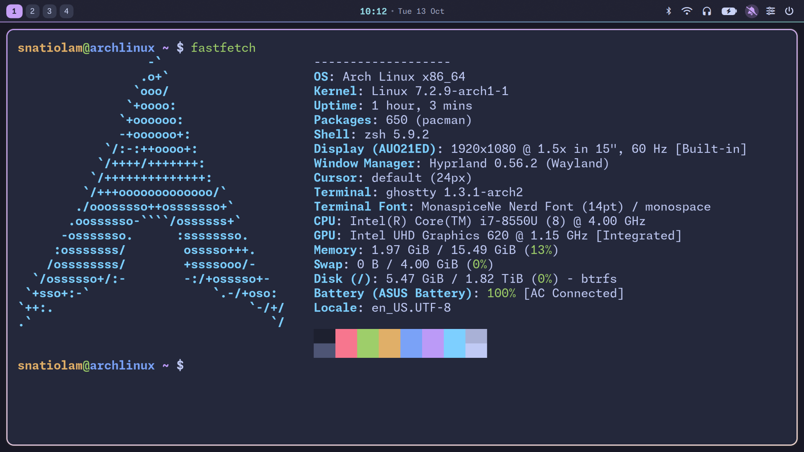

# Snatiolam Dotfiles & Configs



***Quick links***

| Config | Entry point | More |
| --- | --- | --- |
| **Hyprland** | [hyprland.lua](.config/hypr/hyprland.lua) | [wallpaper · hyprpaper.conf](.config/hypr/hyprpaper.conf) |
| **Neovim** | [init.lua](.config/nvim/init.lua) | [lua/](.config/nvim/lua) (lazy, lsp, remap, vars) · [ftplugin/](.config/nvim/ftplugin) |
| **Quickshell** | [shell.qml](.config/quickshell/shell.qml) | [modules/](.config/quickshell/modules) · [components/](.config/quickshell/components) · [config/](.config/quickshell/config) |

Legacy: [i3wm](.config/i3/config) · [vim](.vimrc) · [polybar](.config/polybar/config)

# Fresh install

After installing Arch with `archinstall` (keep it minimal: base, kernel,
bootloader, drivers, `networkmanager` and `git`), clone this repo and let
`setup.sh` install the packages and the configs:

```sh
git clone <url-of-this-repo> ~/dotfiles
cd ~/dotfiles
./setup.sh --packages   # installs everything in packages.txt
./setup.sh --all        # configs (nvim, zsh, hypr, fonts, ...)
```

The package list lives in [`packages.txt`](packages.txt): one package per
line, with `#` comments. To add something new just edit that file and run
`./setup.sh --packages` again; since it uses `pacman --needed`, whatever is
already installed is left alone, so it is always safe to re-run.

# Table of contents
- [Software](#software-i-use)
  - [Basic utilities](#basic)
  - [Fonts, theming and GTK](#theming)
  - [Apps](#apps)

# Software I Use

## Basic

| Software                                                              | Utility                                      |
| --------------------------------------------------------------------- | -------------------------------------------- |
| [Hyprland](https://hypr.land/)                                        | Wayland compositor (tiling WM)               |
| [Quickshell](https://quickshell.org/)                                 | Status bar, notifications and launcher       |
| [uwsm](https://github.com/Vladimir-csp/uwsm)                          | Wayland session manager                      |
| [greetd](https://wiki.archlinux.org/title/Greetd) + tuigreet          | Display manager (login)                      |
| [networkmanager](https://wiki.archlinux.org/index.php/NetworkManager) | Managing network                             |
| network-manager-applet                                                | networkmanager tray                          |
| [PipeWire](https://wiki.archlinux.org/title/PipeWire) + wireplumber   | Sound server                                 |
| pavucontrol                                                           | GUI for PipeWire                             |
| [udiskie](https://wiki.archlinux.org/index.php/udisks)                | Wrapper of udisks for automount              |
| [rofi](https://github.com/davatorium/rofi)                            | Application launcher                         |
| [cliphist](https://github.com/sentriz/cliphist) + wl-clipboard        | Clipboard history                            |
| [hyprpaper](https://wiki.hypr.land/Hypr-Ecosystem/hyprpaper/)         | Wallpaper                                    |
| [hyprlock](https://wiki.hypr.land/Hypr-Ecosystem/hyprlock/) + hypridle | Lock screen / idle management                |
| hyprsunset                                                            | Night light                                  |
| [polkit](https://wiki.archlinux.org/title/Polkit) + hyprpolkitagent   | Privilege prompts                            |

---
**NOTE**

Audio is handled by PipeWire; if a device or stream is muted, open `pavucontrol`.

---


## Theming

| Software                                                        | Utility                         |
| --------------------------------------------------------------- | ------------------------------- |
| [Catppuccin Macchiato](https://catppuccin.com/)                 | Color scheme                    |
| [nwg-look](https://github.com/nwg-piotr/nwg-look)               | GUI for changing GTK themes     |
| qt6ct                                                           | Qt6 theme configuration         |
| [Nerd Fonts](https://www.nerdfonts.com/) (JetBrains Mono)       | Fonts with icons/glyphs         |
| [Noto fonts](https://fonts.google.com/noto)                     | Base + CJK + emoji fonts        |

### Dark mode

Dark appearance is set **per toolkit**, because GTK3 and GTK4/libadwaita read it
from different sources (there is no single switch that covers both):

| Toolkit                              | Mechanism                              | Where                                                                                                                            |
| ------------------------------------ | -------------------------------------- | -------------------------------------------------------------------------------------------------------------------------------- |
| GTK3 (Thunar, Xfce apps, ...)         | `gtk-application-prefer-dark-theme=1`  | [.config/gtk-3.0/settings.ini](.config/gtk-3.0/settings.ini)                                                                      |
| GTK4 / libadwaita (Ghostty, Nautilus) | freedesktop `color-scheme` (XDG portal) | `gsettings set org.gnome.desktop.interface color-scheme prefer-dark` (run at login from [hyprland.lua](.config/hypr/hyprland.lua)) |

> On GTK 3.24 the theme names `Adwaita-dark` / `adw-gtk3-dark` do **not** turn
> apps dark on their own: if that theme is not installed they silently fall back
> to the *light* Adwaita. Only the `gtk-application-prefer-dark-theme` flag is
> reliable for GTK3, which is why it lives in `settings.ini`.
>
> Note: GTK3 does not reload the theme at runtime, so already-open apps need to
> be restarted after a change.

## Apps

| Software                                                                              | Utility                      |
| ------------------------------------------------------------------------------------- | ---------------------------- |
| [kitty](https://sw.kovidgoyal.net/kitty/) / [ghostty](https://ghostty.org/)           | Terminal emulator            |
| [Neovim](https://neovim.io/) / vim                                                    | Editor                       |
| [grim](https://github.com/emersion/grim) + [slurp](https://github.com/emersion/slurp) | Screenshots                  |
| [firefox](https://www.mozilla.org/firefox/)                                           | Web browser                  |
| [thunar](https://docs.xfce.org/xfce/thunar/start)                                     | GUI file manager             |
| ranger                                                                                | Terminal file manager        |
| [imv](https://sr.ht/~exec64/imv/)                                                     | Image viewer                 |
| [evince](https://wiki.gnome.org/Apps/Evince)                                          | PDF / document viewer        |
| [mpv](https://mpv.io/)                                                                | Video player                 |
| [LibreOffice](https://www.libreoffice.org/)                                           | Office suite                 |
| [Qalculate!](https://qalculate.github.io/)                                            | Calculator                   |
| file-roller                                                                           | Archive manager              |
| [btop](https://github.com/aristocratos/btop) / [fastfetch](https://github.com/fastfetch-cli/fastfetch) | System monitor / info |
| [blueman](https://github.com/blueman-project/blueman) + bluez                         | Bluetooth management         |

### File Manager

If you are trying to open your file explorer and is not opening the one you want by default
you can set the default file manager by simply typing.

```sh
application="thunar.desktop"
xdg-mime default $application inode/directory
```
